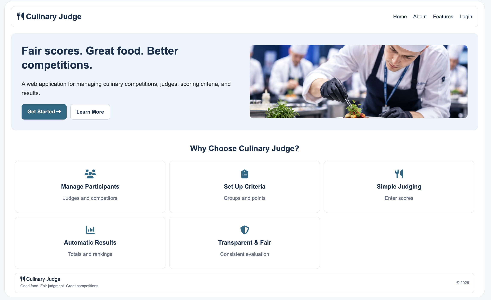
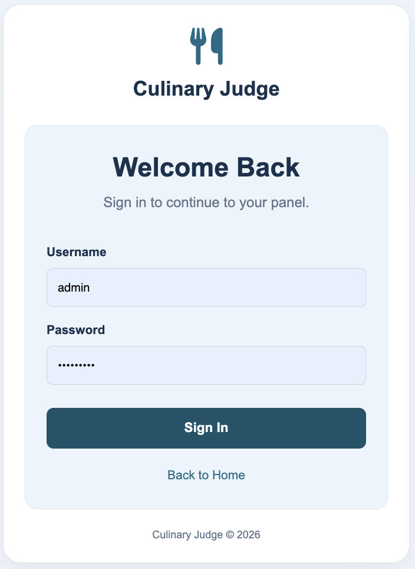
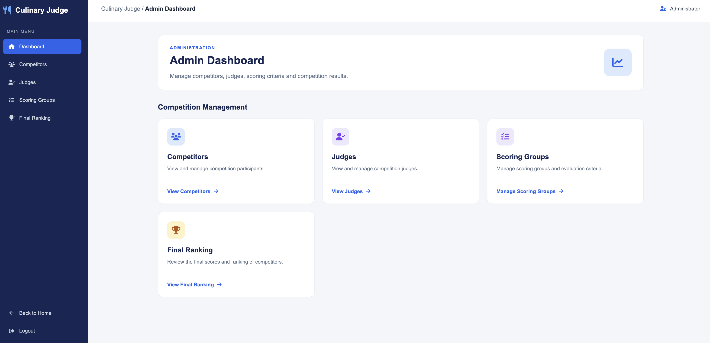
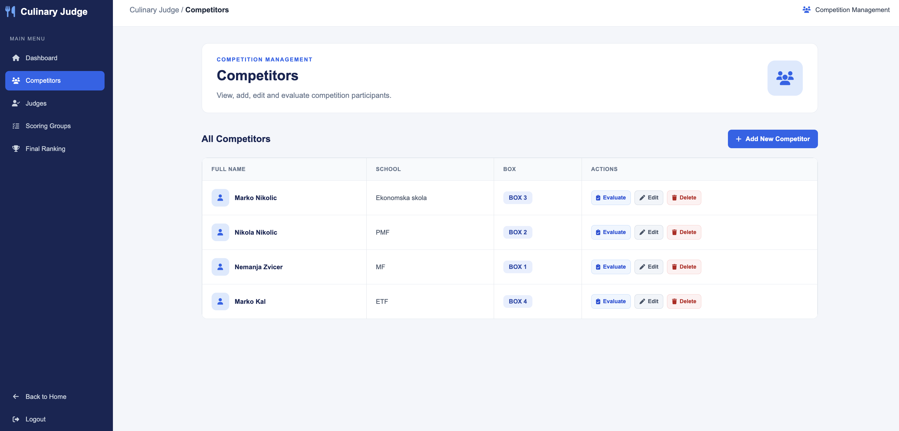
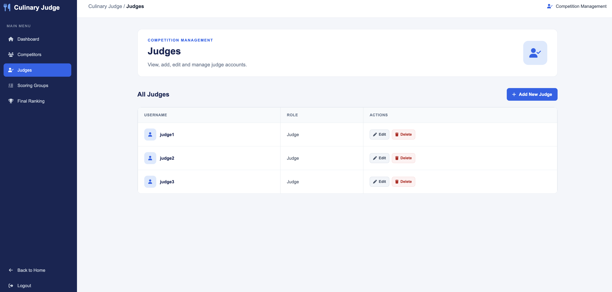
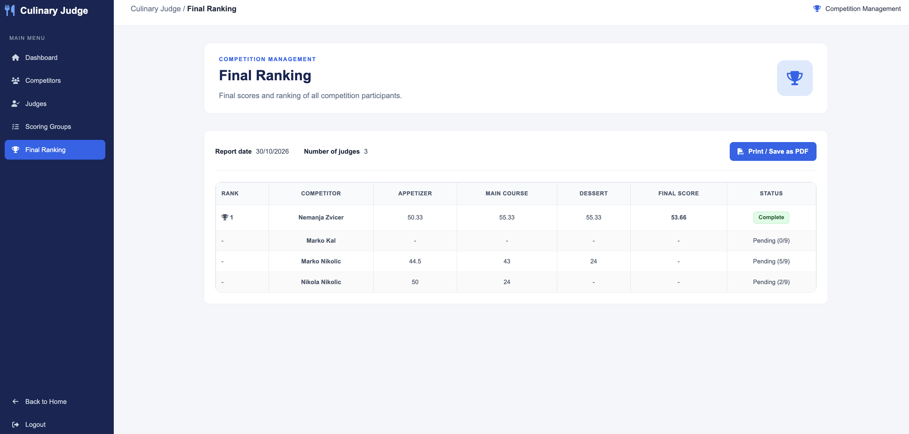
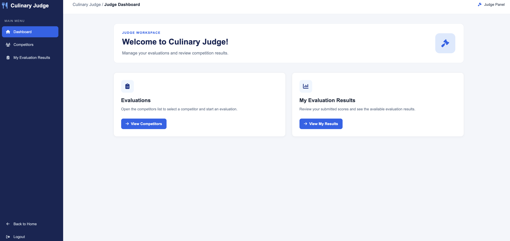
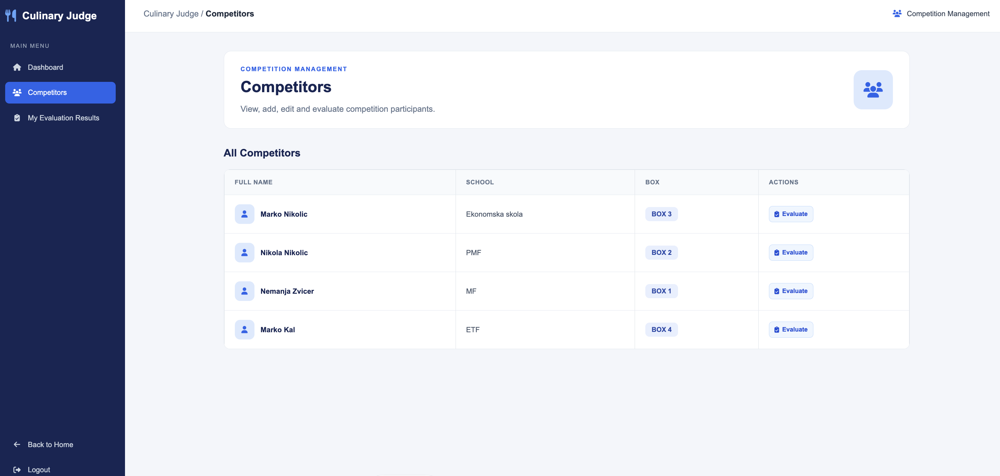
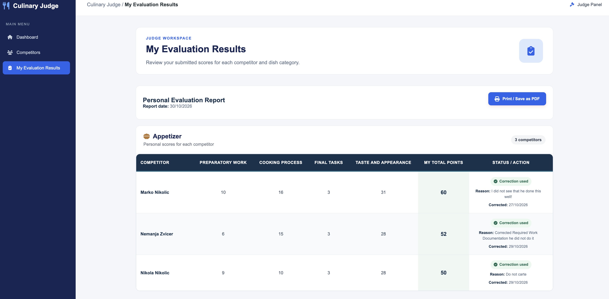

# 🍽️ Culinary Judge

### By: Marko Kaludjerović
#### [GitHub](https://github.com/masjobest-git)
#### Date: October 2026

---

### *Description*

Culinary Judge is a web application designed to manage culinary competitions. It allows administrators to manage competitors and judges, organize scoring groups and evaluation criteria, and view the final ranking of participants.

The project was developed as a full-stack web development learning project, focusing on server-side programming, database relationships, user authentication, CRUD operations, and dynamic views using EJS.

The application includes separate Admin and Judge panels to support competition management and the judging process.

---

### *Technologies Used*

- JavaScript
- Node.js
- Express.js
- MongoDB
- Mongoose
- EJS
- HTML
- CSS
- Express Session
- Git and GitHub

---

### *Getting Started*

### *Main Features*

#### Admin Panel

- Admin login and authentication
- Dashboard for competition management
- Add, edit, and delete competitors
- Create and manage judge accounts
- Create and manage scoring groups
- Add and edit evaluation criteria
- Configure minimum and maximum points for criteria
- View the final competition ranking
- Print or save the ranking as a PDF

#### Judge Panel

- Judge login and authentication
- View competition participants
- Access the judging interface
- Evaluate competitors according to the competition's scoring process
- View submitted evaluation results

#### Scoring and Results

- Organize evaluation criteria into scoring groups
- Manage scoring criteria and their point ranges
- Display appetizer, main course, and dessert scores
- Show the final score and ranking
- Track evaluation completion status

---

### *Future Updates*

- Connect configurable scoring groups directly to the evaluation forms
- Improve score calculation and averaging
- Add more detailed competition reports
- Improve validation and error handling
- Improve the user interface and responsiveness
- Add additional competition management features

---

### *Screenshots*

#### Main page (Home page)

#### Culinary Judge — Login Page

#### Culinary Judge — Admin Dashboard

#### Culinary Judge — Competitors

#### Culinary Judge — Judges

#### Culinary Judge — Final Ranking

#### Culinary Judge — Judge Dashboard

#### Culinary Judge — Competitors

#### Culinary Judge — My Evaluation Results

---

### *Credits*

#### Development: Marko Kaludjerović

#### Support and Guidance: General Assembly instructors and colleagues

#### Inspiration: The need for a simple and organized culinary competition management system
